<div align="center">

<picture>
  <source media="(prefers-color-scheme: dark)" srcset="assets/readme/banner-dark.svg">
  
</picture>

<br>

**A native IDE for macOS, drawn on the GPU.**<br>
Debugger, tests, Git, terminal and Claude Code in a single app,<br>
with a quarter of VS Code's memory and the same shortcuts.

<br>


[Why Keel](#why-keel) ·
[Comparison](#by-the-numbers) ·
[Features](#what-it-does) ·
[VS Code](#at-home-from-vs-code) ·
[Extensions](#extensions) ·
[Languages](#languages) ·
[Build it](#build-it) ·
[Architecture](#architecture) ·
[Roadmap](#status-and-roadmap)

**English** · [Italiano](docs/README.it.md)

</div>

<br>

<p align="center">
  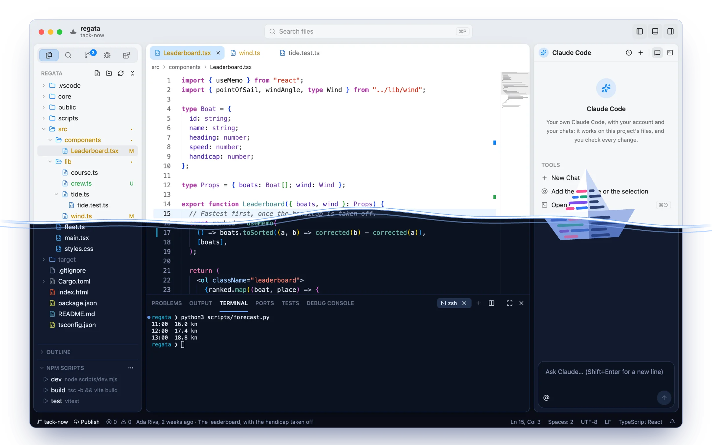
</p>

> [!NOTE]
> **Keel is in pre-release.** Its first version is feature complete and is being tried by hand. There is no signed download yet: to run it today, [build it from source](#build-it).

## Why Keel

A keel is the part of a boat under the water: nobody sees it, and it keeps everything upright. Keel is an editor built that way, with the weight where it helps and nowhere else.

<table>
  <tr>
    <td><b>Light</b></td>
    <td>One process and no browser inside. With a project open it uses 265 MB, where VS Code uses 1,014 and Cursor 1,320.</td>
  </tr>
  <tr>
    <td><b>Native</b></td>
    <td>Rust, and Metal through <a href="https://github.com/zed-industries/zed">GPUI</a>. The first frame is on screen in about a third of a second.</td>
  </tr>
  <tr>
    <td><b>Familiar</b></td>
    <td>VS Code's shortcuts and command names, <code>settings.json</code> and <code>keybindings.json</code> in the same format, extensions from Open VSX.</td>
  </tr>
  <tr>
    <td><b>Complete</b></td>
    <td>Debugger, tests, tasks, Git with its graph, pull requests, terminal, search, Markdown and PDF preview. No extension to install.</td>
  </tr>
  <tr>
    <td><b>With Claude inside</b></td>
    <td>Your own Claude Code, with your account and your chats: in a panel, in the code, in the commit message. You approve every change.</td>
  </tr>
  <tr>
    <td><b>Private</b></td>
    <td>No telemetry. Keel only goes online for the work itself: extensions, language servers, your Git remotes, your pull requests.</td>
  </tr>
</table>

## By the numbers

<p align="center">
  
</p>

| | Keel | VS Code 1.125 | Cursor 3.30 |
|:--|--:|--:|--:|
| Memory, all processes | **265 MB** | 1,014 MB | 1,320 MB |
| Time to start | **425 ms** | 653 ms | 970 ms |
| App on disk | **137 MB** | 1,096 MB | 1,446 MB |
| Processes | **1** | 8 | 14 |

<details>
<summary><b>How this was measured</b></summary>

<br>

On 22 November 2026, on one Mac with an M4 Pro and macOS 27: the same project, the same Rust file open, an empty profile and no extensions. Each figure is the mean of three starts.

- **Memory** is the physical footprint of every process, 40 seconds after the start: the number in Activity Monitor's *Memory* column.
- **Time to start** is, for Keel, until its window is on screen; for VS Code and Cursor, the time they report themselves (`--prof-append-timers`). Their empty window appears at about the same moment as Keel's.
- **Disk** is the app as installed. VS Code and Cursor ship as universal binaries, Keel for Apple Silicon only.
- **Language servers** are off for all three. They are the same programs in every editor, and they come on top.

</details>

## What it does

### Claude, where the code is

<kbd>⌘</kbd> <kbd>I</kbd> on a few lines, say what you want, read the difference, keep it or put it back. Claude can also write the commit message, explain a failed command, or fix a problem from the list.

<p align="center">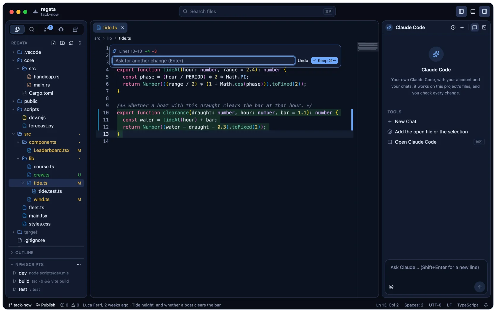</p>

### A real debugger

Breakpoints with conditions and log messages, variables, watched expressions, the call stack, values beside the code and a console, with the adapters VS Code uses and your own `launch.json`.

<p align="center">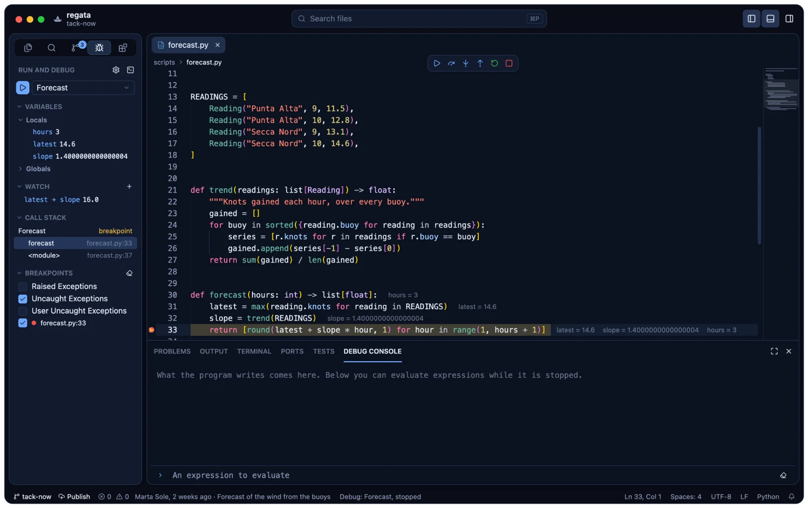</p>

### All of Git

Differences side by side, with the words that changed and the code that moved. Stage a block, undo a block, or correct the lines right there. The graph and the author of every line are part of it.

<p align="center">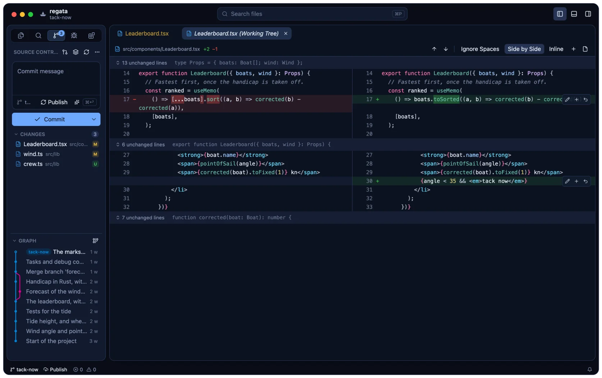</p>

<br>

<table>
  <tr>
    <td width="50%" valign="top">
      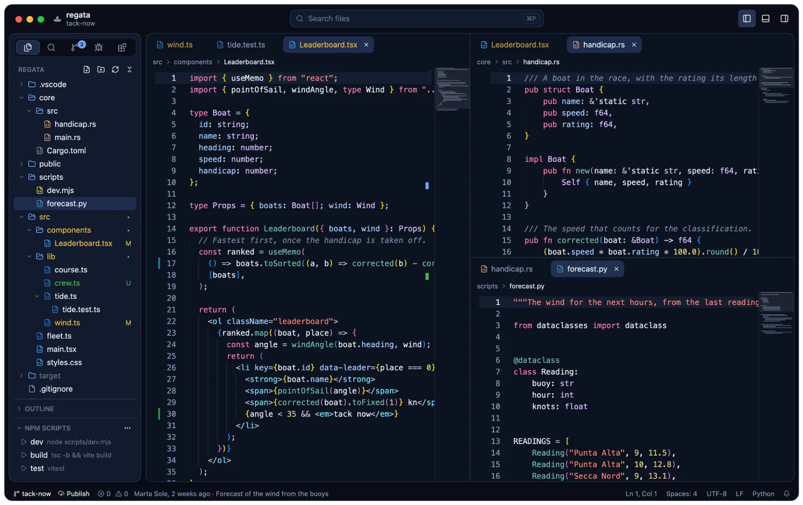
      <p align="center"><b>Split anywhere</b><br>Drag a tab to an edge, beside or below.</p>
    </td>
    <td width="50%" valign="top">
      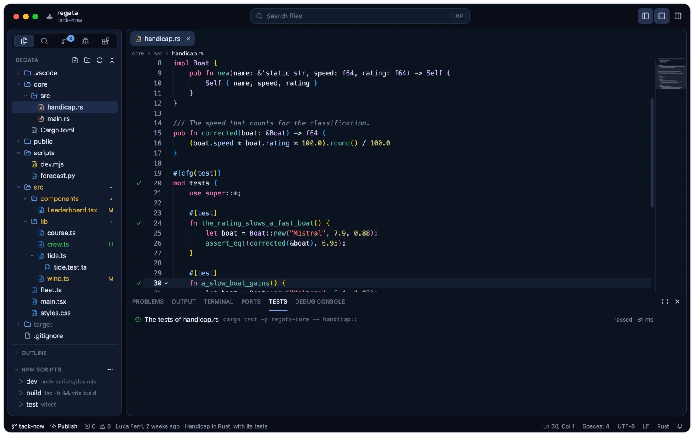
      <p align="center"><b>Tests from the margin</b><br>Rust, Vitest, Jest and pytest.</p>
    </td>
  </tr>
  <tr>
    <td valign="top">
      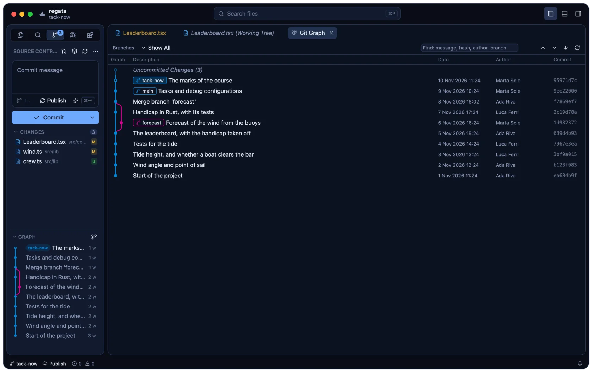
      <p align="center"><b>Git Graph</b><br>Search by message, author or hash.</p>
    </td>
    <td valign="top">
      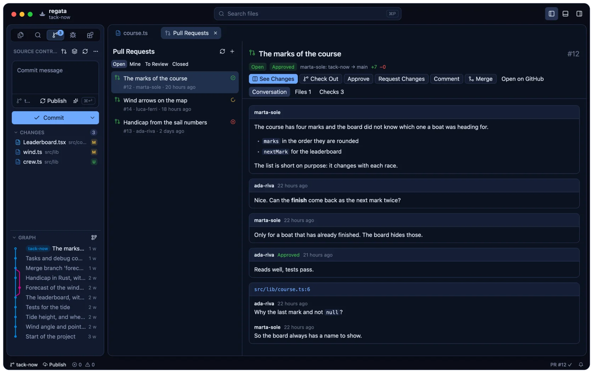
      <p align="center"><b>Pull requests</b><br>Conversation, checks, comments on lines.</p>
    </td>
  </tr>
  <tr>
    <td valign="top">
      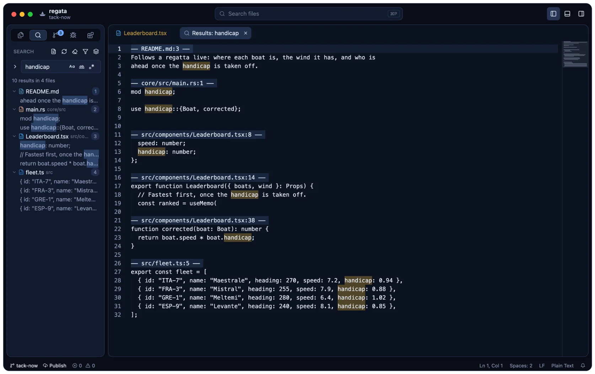
      <p align="center"><b>Editable results</b><br>Correct them in the tab, <kbd>⌘</kbd> <kbd>S</kbd> writes them.</p>
    </td>
    <td valign="top">
      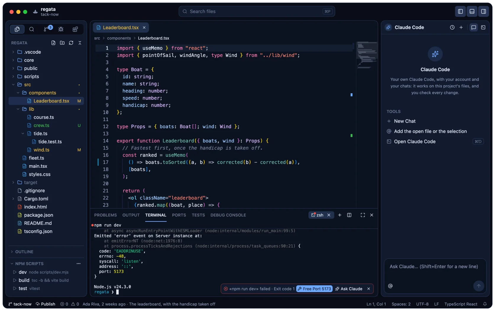
      <p align="center"><b>A terminal that helps</b><br>It knows what failed, and offers the fix.</p>
    </td>
  </tr>
</table>

<details>
<summary><b>Everything, area by area</b></summary>

<br>

| Area | What is there |
|:--|:--|
| **Editor** | Tree-sitter colours, several cursors, folding, sticky scroll, minimap, rulers, bracket colours, snippets, rename, peek definition, call hierarchy, references and types at the end of lines, bookmarks, clipboard history |
| **Files** | Explorer with Git colours, Quick Open, Quick Look, autosave, local history, unsaved files that survive a quit or a crash, changes on disk noticed and compared |
| **Search** | In files with replace, regular expressions, results in a tab that can be edited |
| **Git** | Stage by file or block, side by side or inline differences, moved code, commit, push, pull, sync, the author of each line, the graph, images compared |
| **GitHub** | Pull requests through `gh`: lists, conversation, checks, comments on lines, review, merge, checkout |
| **Debug** | Rust, C, C++ and Swift with lldb-dap, Python with debugpy, Node and TypeScript with js-debug; `launch.json` |
| **Tests** | Rust's `#[test]`, Vitest, Jest and pytest, run or debugged from the margin, with their outcome |
| **Tasks** | `tasks.json`, plus the cargo, npm and TypeScript tasks Keel finds, with their errors in Problems |
| **Terminal** | Splits, shell integration, jumps between commands, quick fixes, text that comes back after a restart, open ports |
| **Claude** | The panel with your chats, <kbd>⌘</kbd> <kbd>I</kbd>, the commit message, fixes from Problems and from the terminal, the IDE link for Claude Code |
| **Preview** | Markdown and PDF |
| **The Mac** | Native menus, recent projects in the Dock, files dragged to and from Finder, notifications, light and dark with the system |

</details>

## At home from VS Code

Keep your fingers where they are. Keel uses VS Code's command ids, so your `keybindings.json` works as it is, and **Import from Cursor** brings your extensions along.

<table>
  <tr>
    <td><kbd>⌘</kbd> <kbd>P</kbd></td>
    <td>Go to file</td>
    <td><kbd>⌘</kbd> <kbd>⇧</kbd> <kbd>P</kbd></td>
    <td>Command palette</td>
  </tr>
  <tr>
    <td><kbd>⌘</kbd> <kbd>⇧</kbd> <kbd>F</kbd></td>
    <td>Search in files</td>
    <td><kbd>⌃</kbd> <kbd>⇧</kbd> <kbd>G</kbd></td>
    <td>Source control</td>
  </tr>
  <tr>
    <td><kbd>⌘</kbd> <kbd>&#92;</kbd></td>
    <td>Split the editor</td>
    <td><kbd>⌃</kbd> <kbd>&#96;</kbd></td>
    <td>Terminal</td>
  </tr>
  <tr>
    <td><kbd>F5</kbd></td>
    <td>Start debugging</td>
    <td><kbd>F9</kbd></td>
    <td>Toggle a breakpoint</td>
  </tr>
  <tr>
    <td><kbd>⌘</kbd> <kbd>;</kbd> <kbd>C</kbd></td>
    <td>Test at the cursor</td>
    <td><kbd>⌘</kbd> <kbd>⇧</kbd> <kbd>B</kbd></td>
    <td>Build</td>
  </tr>
  <tr>
    <td><kbd>⌘</kbd> <kbd>I</kbd></td>
    <td>Claude in the code</td>
    <td><kbd>⌘</kbd> <kbd>⇧</kbd> <kbd>Esc</kbd></td>
    <td>Claude's panel</td>
  </tr>
</table>

## Extensions

Keel runs VS Code extensions from [Open VSX](https://open-vsx.org) through a bridge of its own, in a V8 engine inside the app. It says what to expect before you install one.

<table>
  <tr>
    <td><b>Already aboard</b></td>
    <td>Formatting with your project's Prettier, Git Graph, blame on every line, ESLint, Tailwind, Markdown and PDF preview, pull requests, Claude Code. They are part of Keel.</td>
  </tr>
  <tr>
    <td><b>Come as they are</b></td>
    <td>Color themes, file icons, snippets, languages, settings, commands and shortcuts, and the code behind many of them. Tried with Dracula, Material Icon Theme, markdownlint, gitignore and Peacock.</td>
  </tr>
  <tr>
    <td><b>Stay ashore</b></td>
    <td>The ones that need web pages of their own, notebooks, a full Node or another computer, like Jupyter and Remote SSH. Keel tells you first, and why.</td>
  </tr>
</table>

## Languages

Open a file and Keel installs the right server by itself: the same engines VS Code's extensions use, so you get the same errors and the same suggestions.

| Language | Server | Language | Server |
|:--|:--|:--|:--|
| TypeScript, JavaScript, React | `vtsls` | HTML, CSS, JSON | `vscode-langservers` |
| Rust | `rust-analyzer` | Tailwind CSS | `tailwindcss` |
| Python | `basedpyright`, `ruff` | ESLint, Emmet | `eslint`, `emmet` |
| Java, Spring Boot | `jdtls`, `spring-boot` | Prisma | `prisma` |
| C, C++, Objective-C | `clangd` | Markdown | `marksman` |
| C# | `csharp-ls` | YAML, TOML | `yaml`, `taplo` |
| Bash | `bash`, ShellCheck, shfmt | XML | `lemminx` |
| Dockerfile | `dockerfile` | SQL | `sqruff` |

## Themes

<table>
  <tr>
    <td width="33%">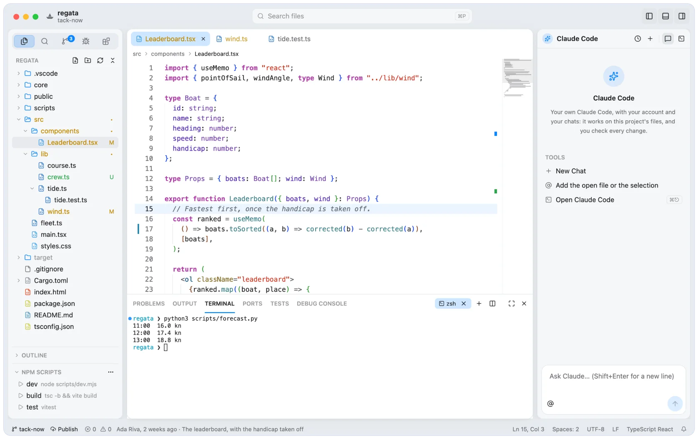<p align="center"><b>Chiaro</b></p></td>
    <td width="33%">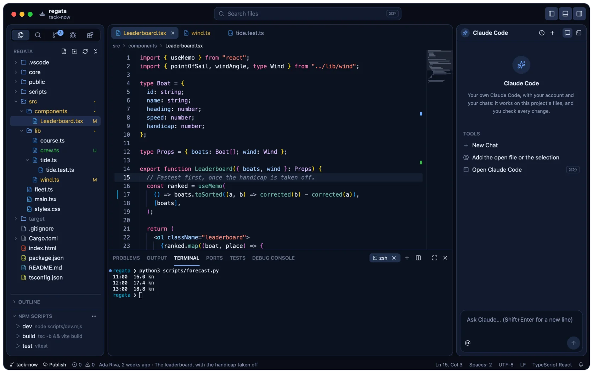<p align="center"><b>Mezzanotte</b></p></td>
    <td width="33%">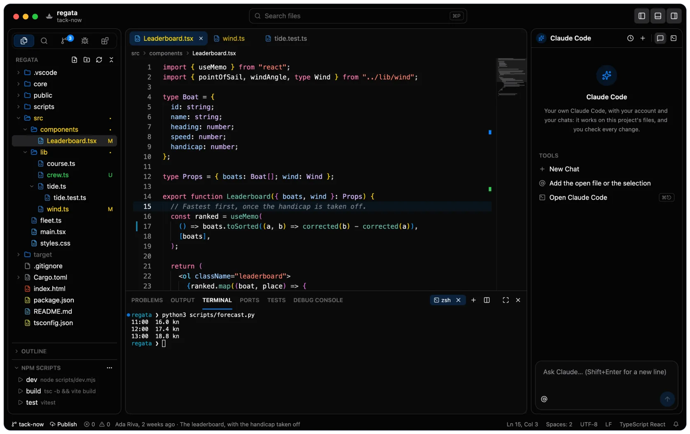<p align="center"><b>Nero</b></p></td>
  </tr>
</table>

Daylight, midnight and black, in two styles of window: floating panels or flat. Any VS Code color theme works too.

## Build it

**You need** a Mac with Apple Silicon and macOS 13 or later, [rustup](https://rustup.rs), and Xcode with the Metal toolchain, selected with `xcode-select`. The Rust version in `rust-toolchain.toml` installs itself.

```bash
git clone https://github.com/Manuel-Mezzanotte/Keel.git
cd Keel

cargo run -p keel                # run it
scripts/bundle-macos.sh          # or make target/release/Keel.app
scripts/make-dmg.sh              # or a disk image to install it from
```

The app has an ad hoc signature: it opens on the Mac that built it. Elsewhere macOS will warn about it until Keel is signed and notarized.

## Architecture

Keel is a Cargo workspace. The interface lives in one crate; the others draw nothing and are tested on their own.

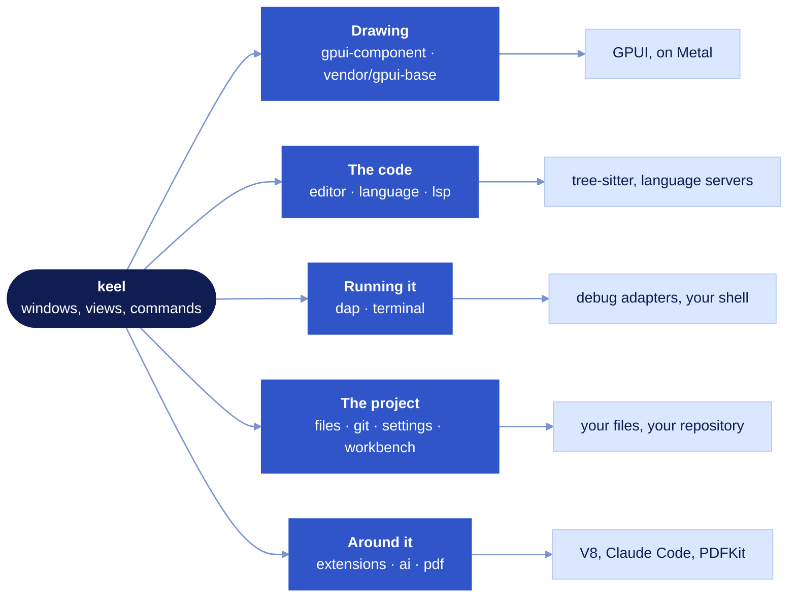

<details>
<summary><b>The crates, one by one</b></summary>

<br>

| Crate | What it does |
|:--|:--|
| `crates/keel` | The app: windows, interface, every view |
| `crates/editor` | What the editor adds: decorations, ghost text, commands on lines |
| `crates/extensions` | VSIX reader, Open VSX, the V8 host and its `vscode` bridge |
| `crates/lsp` | Language server client, their installation, the languages |
| `crates/dap` | Debug adapter client (DAP), and where the adapters are |
| `crates/language` | Tree-sitter grammars and the registry of languages |
| `crates/files` | File tree, search in files, fuzzy matching, trash |
| `crates/git` | Status, differences, commits, graph |
| `crates/terminal` | Terminals on `alacritty_terminal`, open ports |
| `crates/settings` | User and project settings, JSONC with its comments kept |
| `crates/workbench` | Logic shared with the bridge: shortcuts, `when` clauses, URIs |
| `crates/ai` | Claude Code: the IDE protocol and the ACP agent panel |
| `crates/pdf` | PDF preview with PDFKit |
| `crates/update` | Keel's own updates: the list of releases, the checked download, the swap of the app |
| `vendor/gpui-base` | gpui-component's editor, with the changes Keel needs ([list](vendor/gpui-base/KEEL.md)) |

</details>

## Development

```bash
cargo test --workspace                     # 542 tests, with no window on screen
cargo clippy --workspace --all-targets     # no warnings
scripts/snapshots.sh <folder>              # the window drawn off screen, as PNG
```

- Set `KEEL_DATA_DIR` to a folder of its own when trying things, so your real settings stay untouched.
- Commits follow [Conventional Commits](https://www.conventionalcommits.org). Code and commits are in English, the documents in `docs/` in Italian.

| Document | |
|:--|:--|
| [`docs/HANDOFF.md`](docs/HANDOFF.md) | Where the project stands, what is done and what is left |
| [`docs/PIANO.md`](docs/PIANO.md) | The plan, phase by phase, with decisions and measurements |
| [`docs/DETTAGLI.md`](docs/DETTAGLI.md) | The small details, the new features and how to try them |

## Privacy

Keel collects nothing. It connects only to:

- **keel.mezzalab.eu**, once at start, to see if there is a new version of Keel (Settings → Updates turns it off), and when you download one;
- **Open VSX**, when you search, install or update extensions;
- **the sites of the language servers and debug adapters** it installs, each checked against a published checksum where there is one;
- **the JSON schemas** those servers ask for, such as the one of `package.json`, from SchemaStore and the sites of their tools;
- **your Git remotes**, when you push and pull, and every few minutes to see if there are new commits (`git.autofetch` turns it off);
- **GitHub**, through your own `gh`, when you open pull requests;
- **Claude**, through your own Claude Code, when you use it.

## Status and roadmap

The thirteen phases of the plan are done, from the first prototype to the debugger and the pull requests. What comes next:

- [ ] Less graphics memory when a file is open, and less work at rest
- [ ] Node and TypeScript debugging tried for real
- [ ] Commit message in a large tab
- [ ] A tab dragged out into a window of its own
- [ ] Your own `style.css`, to restyle any part of Keel
- [ ] Signed and notarized builds, with automatic updates

<details>
<summary><b>Known limits</b></summary>

<br>

- Types and references are written at the end of the line; parameter names are not shown.
- Groups stacked one above the other share the same height.
- The debugger does not show values on hover, and has no function or data breakpoints.
- Tasks never start by themselves when a folder opens, and tasks contributed by extensions are not read.
- Extensions with web views, notebooks or a full Node runtime do not run.

</details>

## Acknowledgements

Keel stands on [GPUI](https://github.com/zed-industries/zed), the GPU framework made for Zed, and on [gpui-component](https://github.com/longbridge/gpui-component), both under the Apache 2.0 licence. It also uses [deno_core](https://github.com/denoland/deno_core) for extensions, [alacritty_terminal](https://github.com/alacritty/alacritty) for terminals and [tree-sitter](https://tree-sitter.github.io) for the colours of the code.

Keel is not affiliated with Microsoft, Anysphere, Anthropic, GitHub or Apple. Visual Studio Code, Cursor, Claude, GitHub and Mac are trademarks of their owners.

## License

No licence has been chosen yet, so all rights are reserved for now. The files in `vendor/gpui-base` keep their own [Apache 2.0 licence](vendor/gpui-base/LICENSE-APACHE).

<br>

<div align="center">
  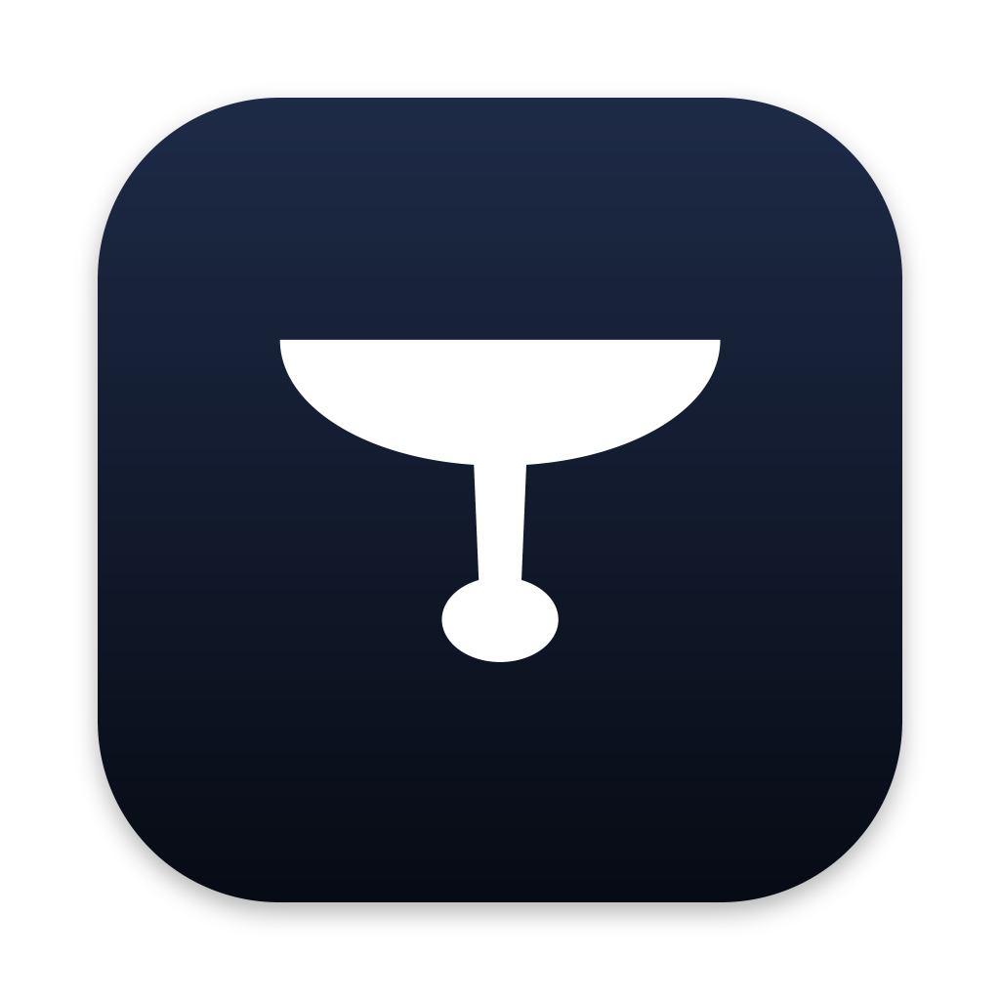
  <br>
  <sub>Written in Rust, drawn with Metal.</sub>
</div>
