<div align="center">

<picture>
  <source media="(prefers-color-scheme: dark)" srcset="../assets/readme/banner-dark.svg">
  
</picture>

<br>

**Un IDE nativo per macOS, disegnato dalla scheda video.**<br>
Debugger, test, Git, terminale e Claude Code in un'app sola,<br>
con un quarto della memoria di VS Code e le stesse scorciatoie.

**[keel.mezzalab.eu](https://keel.mezzalab.eu)** · [Scarica](https://keel.mezzalab.eu/download/) · [Novità](https://keel.mezzalab.eu/changelog/)

<br>


[Perché Keel](#perché-keel) ·
[Confronto](#i-numeri) ·
[Funzioni](#cosa-fa) ·
[VS Code](#per-chi-viene-da-vs-code) ·
[Estensioni](#estensioni) ·
[Linguaggi](#linguaggi) ·
[Costruirlo](#costruirlo) ·
[Architettura](#architettura) ·
[Cosa manca](#a-che-punto-è)

[English](../README.md) · **Italiano**

</div>

<br>

https://github.com/user-attachments/assets/a0a01bb9-4cb1-43b5-9d88-5e27c818ede7

> [!NOTE]
> **Keel è in anteprima.** Si scarica da [keel.mezzalab.eu](https://keel.mezzalab.eu) e si aggiorna da solo. Cosa cambia in ogni versione è in [CHANGELOG.it.md](CHANGELOG.it.md).

## Perché Keel

La chiglia (in inglese *keel*) è la parte della barca sotto l'acqua: non la vede nessuno, e tiene dritto tutto il resto. Keel è un editor fatto così, con il peso dove serve e da nessun'altra parte.

<table>
  <tr>
    <td><b>Leggero</b></td>
    <td>Un processo solo e nessun browser dentro. Con un progetto aperto usa 265 MB, VS Code 1.014 e Cursor 1.320.</td>
  </tr>
  <tr>
    <td><b>Nativo</b></td>
    <td>Rust, e Metal attraverso <a href="https://github.com/zed-industries/zed">GPUI</a>. La prima schermata arriva in circa un terzo di secondo.</td>
  </tr>
  <tr>
    <td><b>Familiare</b></td>
    <td>Le scorciatoie e i nomi dei comandi di VS Code, <code>settings.json</code> e <code>keybindings.json</code> nello stesso formato, le estensioni di Open VSX.</td>
  </tr>
  <tr>
    <td><b>Completo</b></td>
    <td>Debugger, test, attività, Git con il grafico, pull request, terminale, ricerca, anteprima Markdown e PDF. Nessuna estensione da installare.</td>
  </tr>
  <tr>
    <td><b>Con Claude dentro</b></td>
    <td>Il tuo Claude Code, con il tuo account e le tue chat: nel pannello, nel codice, nel messaggio del commit. Ogni modifica la approvi tu.</td>
  </tr>
  <tr>
    <td><b>Riservato</b></td>
    <td>Nessuna statistica d'uso. Keel va in rete solo per il lavoro: estensioni, language server, i tuoi remoti Git, le tue pull request.</td>
  </tr>
</table>

## I numeri

<p align="center">
  
</p>

| | Keel | VS Code 1.125 | Cursor 3.30 |
|:--|--:|--:|--:|
| Memoria, tutti i processi | **265 MB** | 1.014 MB | 1.320 MB |
| Avvio | **425 ms** | 653 ms | 970 ms |
| App su disco | **137 MB** | 1.096 MB | 1.446 MB |
| Processi | **1** | 8 | 14 |

<details>
<summary><b>Come è stato misurato</b></summary>

<br>

Il 22 novembre 2026, su un Mac con M4 Pro e macOS 27: lo stesso progetto, lo stesso file Rust aperto, un profilo vuoto e nessuna estensione. Ogni numero è la media di tre avvii.

- **Memoria:** quella di tutti i processi, 40 secondi dopo l'avvio, come nella colonna *Memoria* di Monitoraggio Attività.
- **Avvio:** per Keel fino alla finestra sullo schermo; per VS Code e Cursor il tempo che dichiarano loro (`--prof-append-timers`). La loro finestra vuota compare più o meno quando quella di Keel.
- **Su disco:** l'app installata. VS Code e Cursor sono universali, Keel è solo per Apple Silicon.
- **Language server:** spenti per tutti. Sono gli stessi programmi in ogni editor, e si aggiungono.

</details>

## Cosa fa

### Claude, dove sta il codice

<kbd>⌘</kbd> <kbd>I</kbd> su qualche riga, dici cosa vuoi, leggi la differenza, la tieni o la annulli. Claude può anche scrivere il messaggio del commit, spiegare un comando fallito o correggere un problema dall'elenco.

<p align="center">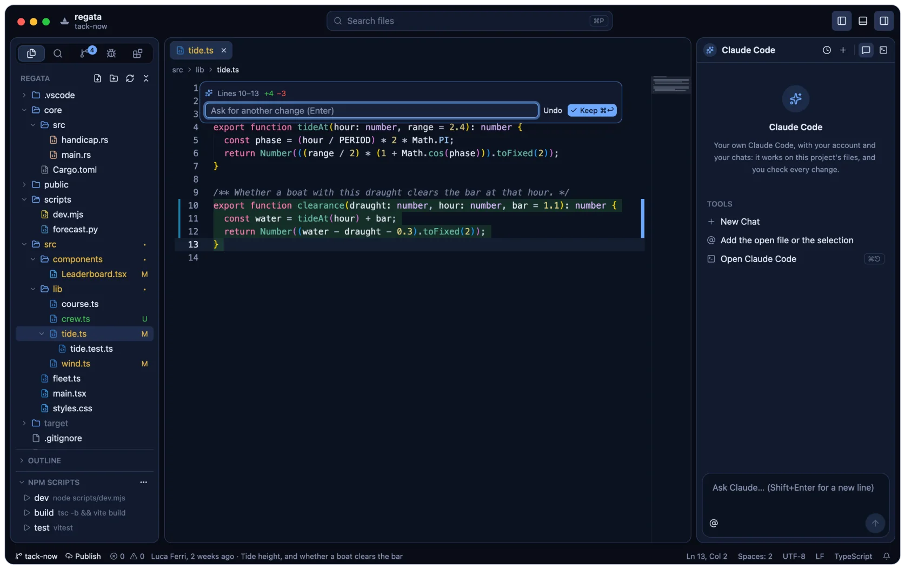</p>

### Un debugger vero

Punti di interruzione con condizioni e messaggi, variabili, espressioni, stack di chiamate, valori accanto al codice e una console, con gli adattatori di VS Code e il tuo `launch.json`.

<p align="center">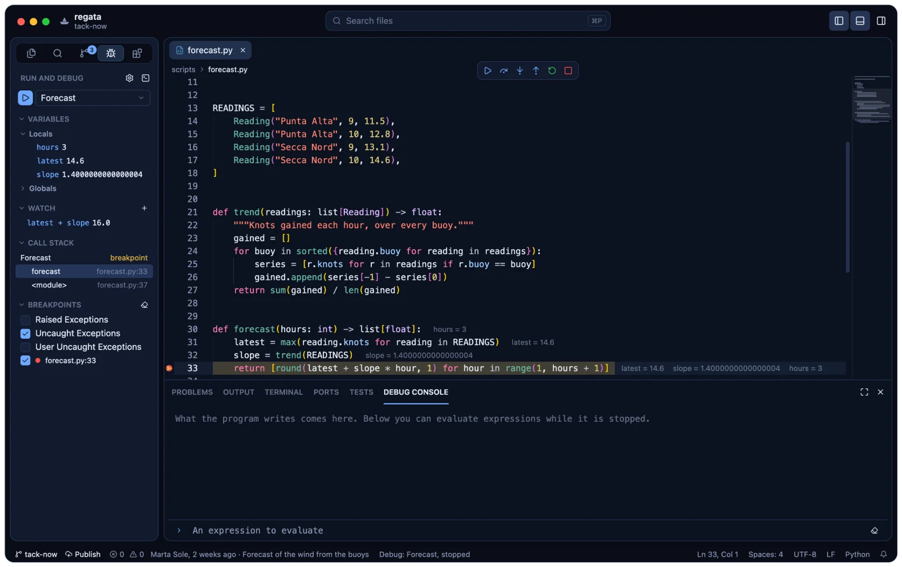</p>

### Git, tutto

Differenze affiancate, con le parole cambiate e il codice spostato. Metti in stage un blocco, annullalo, o correggi le righe lì dove sono. Il grafico e l'autore di ogni riga ne fanno parte.

<p align="center">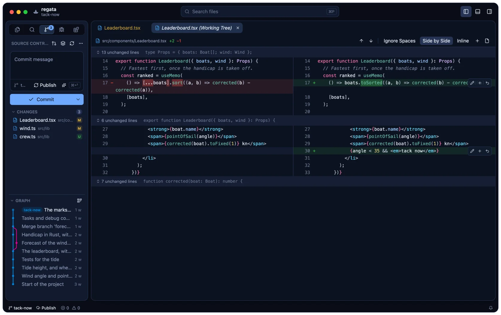</p>

<br>

<table>
  <tr>
    <td width="50%" valign="top">
      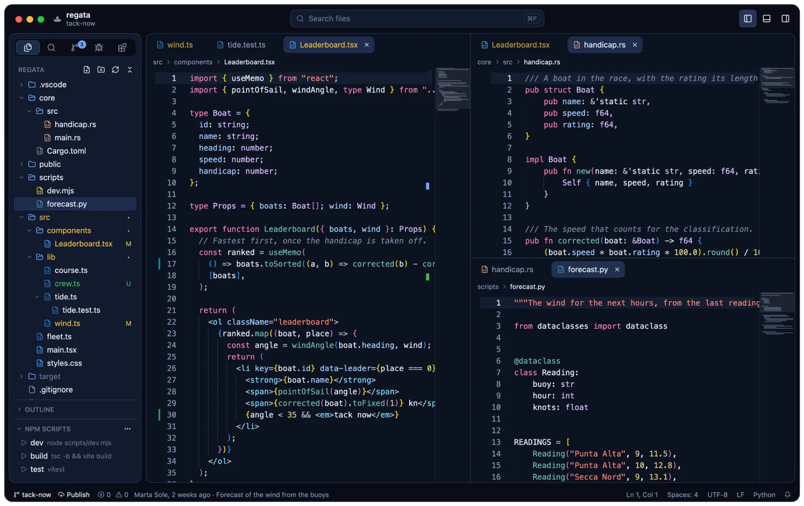
      <p align="center"><b>Dividi dove vuoi</b><br>Trascina una scheda su un bordo, di fianco o sotto.</p>
    </td>
    <td width="50%" valign="top">
      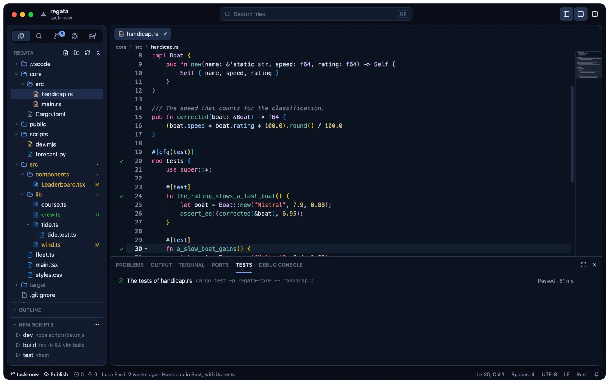
      <p align="center"><b>Test dal margine</b><br>Rust, Vitest, Jest e pytest.</p>
    </td>
  </tr>
  <tr>
    <td valign="top">
      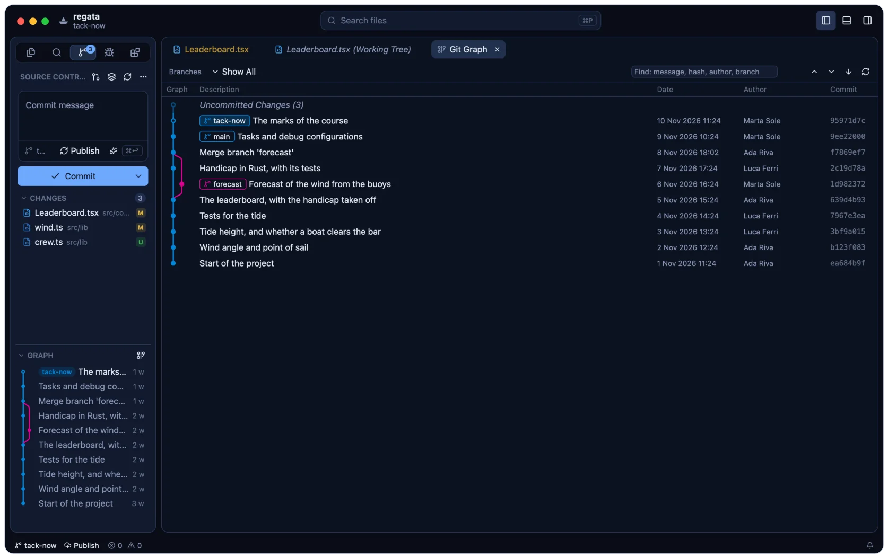
      <p align="center"><b>Git Graph</b><br>Si cerca per messaggio, autore o hash.</p>
    </td>
    <td valign="top">
      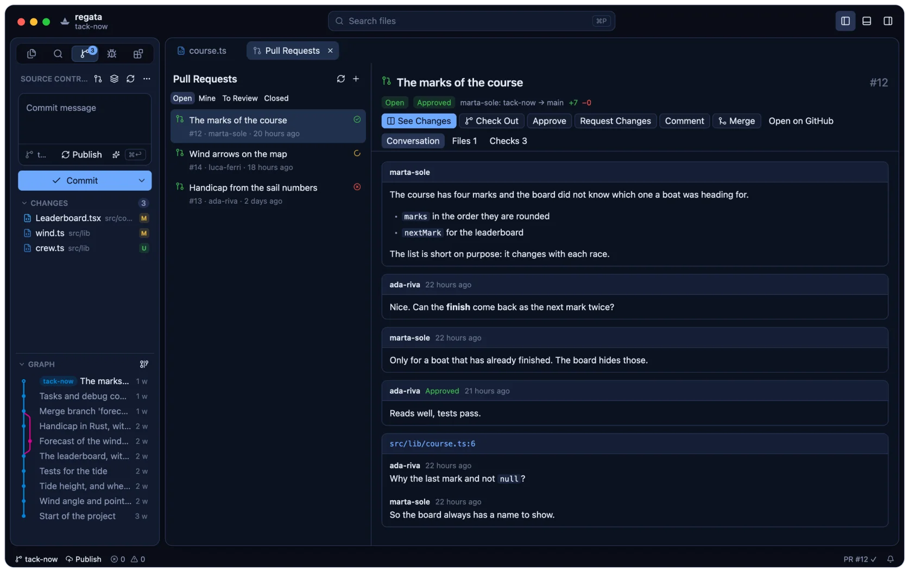
      <p align="center"><b>Pull request</b><br>Conversazione, controlli, commenti sulle righe.</p>
    </td>
  </tr>
  <tr>
    <td valign="top">
      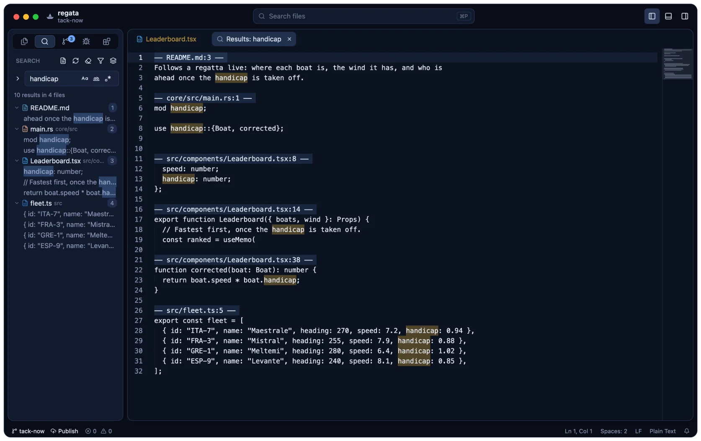
      <p align="center"><b>Risultati modificabili</b><br>Li correggi nella scheda, <kbd>⌘</kbd> <kbd>S</kbd> li scrive.</p>
    </td>
    <td valign="top">
      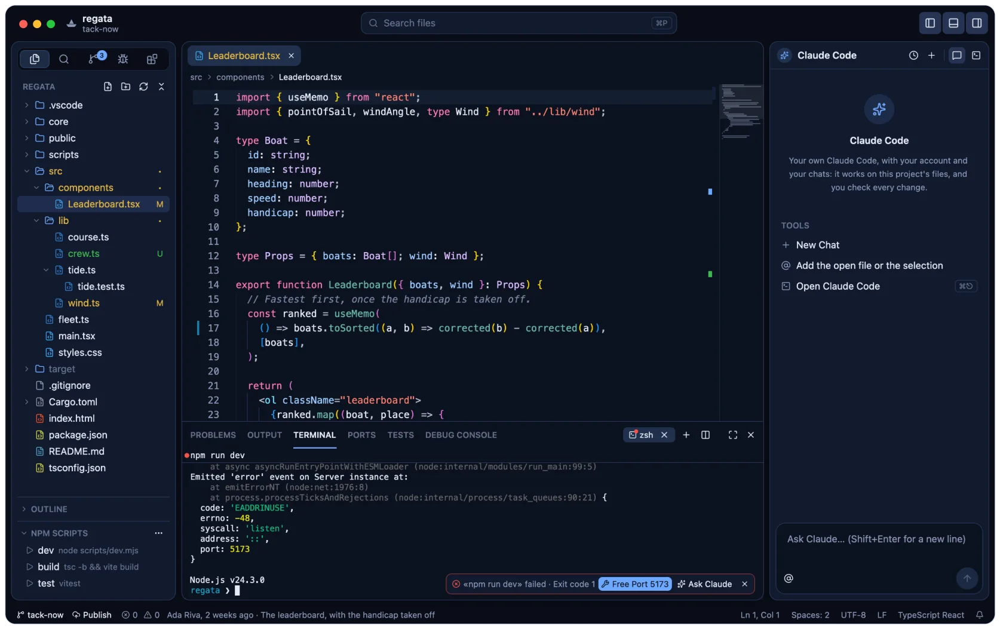
      <p align="center"><b>Un terminale che aiuta</b><br>Sa cosa è fallito e propone il rimedio.</p>
    </td>
  </tr>
</table>

<details>
<summary><b>Tutto, area per area</b></summary>

<br>

| Area | Cosa c'è |
|:--|:--|
| **Editor** | Colori con tree-sitter, più cursori, pieghe, sticky scroll, minimappa, righelli, parentesi colorate, snippet, rinomina, sbircia la definizione, gerarchia delle chiamate, riferimenti e tipi in fondo alla riga, segnalibri, cronologia degli appunti |
| **File** | Esplora risorse con i colori di Git, Cmd+P, Quick Look, salvataggio automatico, cronologia locale, file non salvati che tornano dopo una chiusura o un crash, cambi dal disco notati e confrontati |
| **Ricerca** | Nei file con sostituzione, espressioni regolari, risultati in una scheda modificabile |
| **Git** | Stage per file o blocco, differenze affiancate o in linea, codice spostato, commit, push, pull, sincronizzazione, autore di ogni riga, grafico, immagini a confronto |
| **GitHub** | Pull request attraverso `gh`: elenchi, conversazione, controlli, commenti sulle righe, revisione, unione, passaggio al ramo |
| **Debug** | Rust, C, C++ e Swift con lldb-dap, Python con debugpy, Node e TypeScript con js-debug; `launch.json` |
| **Test** | `#[test]` di Rust, Vitest, Jest e pytest, eseguiti o in debug dal margine, con l'esito |
| **Attività** | `tasks.json`, più quelle di cargo, npm e TypeScript che Keel trova, con gli errori nei Problemi |
| **Terminale** | Divisioni, integrazione della shell, salti fra i comandi, correzioni rapide, testo che torna dopo il riavvio, porte aperte |
| **Claude** | Il pannello con le tue chat, in comune con Claude Code nel terminale: accesso, modello e modo, `/` per i comandi e le tue skill, `@` per ogni file o cartella. <kbd>⌘</kbd> <kbd>I</kbd>, il messaggio del commit, correzioni dai Problemi e dal terminale, il collegamento per Claude Code |
| **Anteprima** | Markdown e PDF |
| **Il Mac** | Menu veri, progetti recenti nel Dock, file trascinati da e verso il Finder, notifiche, chiaro e scuro con il sistema |

</details>

## Per chi viene da VS Code

Le dita restano dove sono. Keel usa gli id dei comandi di VS Code, quindi il tuo `keybindings.json` funziona così com'è, e **Importa da VS Code** (o da Cursor) porta impostazioni, scorciatoie, frammenti, progetti recenti ed estensioni. Il comando `keel` apre le cartelle dal Terminale, come `code`.

<table>
  <tr>
    <td><kbd>⌘</kbd> <kbd>P</kbd></td>
    <td>Vai a un file</td>
    <td><kbd>⌘</kbd> <kbd>⇧</kbd> <kbd>P</kbd></td>
    <td>Tavolozza dei comandi</td>
  </tr>
  <tr>
    <td><kbd>⌘</kbd> <kbd>⇧</kbd> <kbd>F</kbd></td>
    <td>Cerca nei file</td>
    <td><kbd>⌃</kbd> <kbd>⇧</kbd> <kbd>G</kbd></td>
    <td>Controllo versione</td>
  </tr>
  <tr>
    <td><kbd>⌘</kbd> <kbd>&#92;</kbd></td>
    <td>Dividi l'editor</td>
    <td><kbd>⌃</kbd> <kbd>&#96;</kbd></td>
    <td>Terminale</td>
  </tr>
  <tr>
    <td><kbd>F5</kbd></td>
    <td>Avvia il debug</td>
    <td><kbd>F9</kbd></td>
    <td>Punto di interruzione</td>
  </tr>
  <tr>
    <td><kbd>⌘</kbd> <kbd>;</kbd> <kbd>C</kbd></td>
    <td>Test al cursore</td>
    <td><kbd>⌘</kbd> <kbd>⇧</kbd> <kbd>B</kbd></td>
    <td>Compila</td>
  </tr>
  <tr>
    <td><kbd>⌘</kbd> <kbd>I</kbd></td>
    <td>Claude nel codice</td>
    <td><kbd>⌘</kbd> <kbd>⇧</kbd> <kbd>Esc</kbd></td>
    <td>Pannello di Claude</td>
  </tr>
</table>

## Estensioni

Keel fa girare le estensioni di VS Code prese da [Open VSX](https://open-vsx.org) con un ponte suo, in un motore V8 dentro l'app. Prima di installarne una, dice cosa aspettarsi.

<table>
  <tr>
    <td><b>Già a bordo</b></td>
    <td>Formattazione con il Prettier del progetto, Git Graph, autore di ogni riga, ESLint, Tailwind, anteprima Markdown e PDF, pull request, Claude Code. Sono parte di Keel.</td>
  </tr>
  <tr>
    <td><b>Salgono come sono</b></td>
    <td>Temi colori, icone dei file, snippet, linguaggi, impostazioni, comandi e scorciatoie, e il codice di molte di loro. Provate con Dracula, Material Icon Theme, markdownlint, gitignore e Peacock.</td>
  </tr>
  <tr>
    <td><b>Restano a terra</b></td>
    <td>Quelle che vogliono pagine web proprie, i notebook, un Node completo o un altro computer, come Jupyter e Remote SSH. Keel te lo dice prima, e perché.</td>
  </tr>
</table>

## Linguaggi

Apri un file e Keel installa da solo il server giusto: gli stessi motori delle estensioni di VS Code, quindi gli stessi errori e gli stessi suggerimenti.

| Linguaggio | Server | Linguaggio | Server |
|:--|:--|:--|:--|
| TypeScript, JavaScript, React | `vtsls` | HTML, CSS, JSON | `vscode-langservers` |
| Rust | `rust-analyzer` | Tailwind CSS | `tailwindcss` |
| Python | `basedpyright`, `ruff` | ESLint, Emmet | `eslint`, `emmet` |
| Java, Spring Boot | `jdtls`, `spring-boot` | Prisma | `prisma` |
| C, C++, Objective-C | `clangd` | Markdown | `marksman` |
| C# | `csharp-ls` | YAML, TOML | `yaml`, `taplo` |
| Bash | `bash`, ShellCheck, shfmt | XML | `lemminx` |
| Dockerfile | `dockerfile` | SQL | `sqruff` |

## Temi

<table>
  <tr>
    <td width="33%">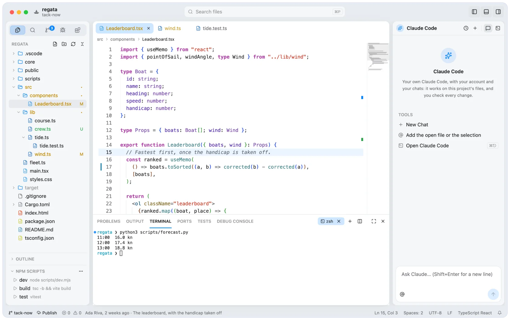<p align="center"><b>Chiaro</b></p></td>
    <td width="33%">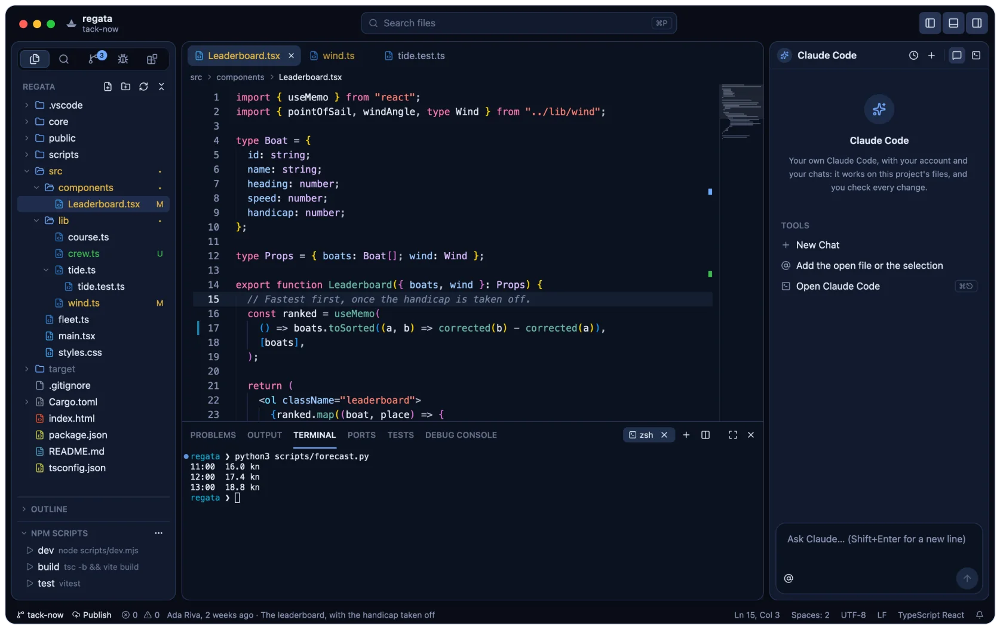<p align="center"><b>Mezzanotte</b></p></td>
    <td width="33%">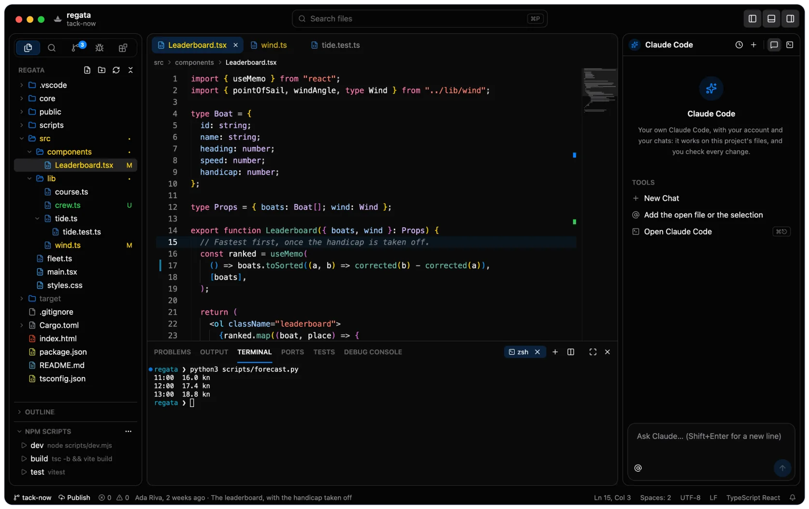<p align="center"><b>Nero</b></p></td>
  </tr>
</table>

Giorno, mezzanotte e nero, in due stili di finestra: pannelli sospesi o piatta. Vale anche ogni tema colori di VS Code.

## Costruirlo

La [licenza](LICENZA.it.md) permette di leggere questo codice, non di copiarlo, compilarlo o avviarlo: per usare Keel, [scaricalo](https://keel.mezzalab.eu/download/). Questi passi sono per l'autore, e per chi lui autorizza per scritto.

**Serve** un Mac con Apple Silicon e macOS 13 o successivo, [rustup](https://rustup.rs) e Xcode con la toolchain di Metal, scelto con `xcode-select`. La versione di Rust scritta in `rust-toolchain.toml` si installa da sola.

```bash
git clone https://github.com/Manuel-Mezzanotte/Keel.git
cd Keel

cargo run -p keel                # avvialo
scripts/bundle-macos.sh          # oppure crea target/release/Keel.app
scripts/make-dmg.sh              # oppure un disco da cui installarlo
```

L'app ha una firma locale: si apre sul Mac che l'ha costruita. Su un altro Mac, macOS avvisa per un'app scaricata con il browser; lo script di installazione del sito evita l'avviso.

## Architettura

Keel è un workspace di Cargo. L'interfaccia sta in un crate solo; gli altri non disegnano niente e si provano da soli.

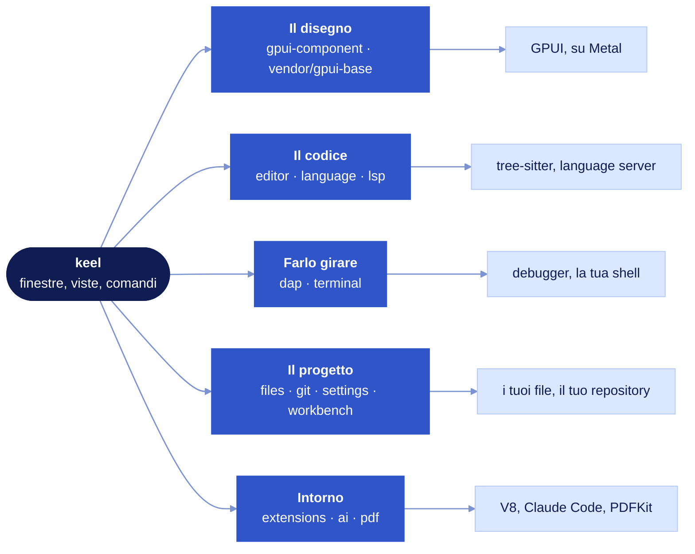

<details>
<summary><b>I crate, uno per uno</b></summary>

<br>

| Crate | Cosa fa |
|:--|:--|
| `crates/keel` | L'app: finestre, interfaccia, tutte le viste |
| `crates/editor` | Aggiunte all'editor: decorazioni, testo fantasma, comandi sulle righe |
| `crates/extensions` | Lettore VSIX, Open VSX, l'host V8 con il ponte `vscode` |
| `crates/lsp` | Client dei language server, la loro installazione, i linguaggi |
| `crates/dap` | Client dei debugger (DAP), e dove si trovano |
| `crates/language` | Grammatiche tree-sitter e registro dei linguaggi |
| `crates/files` | Albero dei file, ricerca nei file, fuzzy matching, cestino |
| `crates/git` | Stato, differenze, commit, grafico |
| `crates/terminal` | Terminali su `alacritty_terminal`, porte aperte |
| `crates/settings` | Impostazioni utente e di progetto, JSONC con i commenti conservati |
| `crates/workbench` | Logica condivisa col ponte: scorciatoie, clausole `when`, URI |
| `crates/ai` | Claude Code: protocollo IDE e pannello agente ACP |
| `crates/pdf` | Anteprima PDF con PDFKit |
| `crates/update` | gli aggiornamenti di Keel: l'elenco delle versioni, il download controllato, la sostituzione dell'app |
| `vendor/gpui-base` | L'editor di gpui-component, con le modifiche che servivano ([elenco](../vendor/gpui-base/KEEL.md)) |

</details>

## Sviluppo

```bash
cargo test --workspace                     # 587 test, senza finestre sullo schermo
cargo clippy --workspace --all-targets     # nessun avviso
scripts/snapshots.sh <cartella>            # la finestra disegnata fuori dallo schermo, in PNG
scripts/third-party-licenses.py            # gli avvisi delle licenze, dopo aver cambiato le dipendenze
```

- Per le prove imposta `KEEL_DATA_DIR` su una cartella a parte, così le tue impostazioni vere non si toccano.
- I commit seguono [Conventional Commits](https://www.conventionalcommits.org). Codice e commit sono in inglese, i documenti in `docs/` in italiano.

| Documento | |
|:--|:--|
| [`HANDOFF.md`](HANDOFF.md) | A che punto è il progetto, cosa è fatto e cosa resta |
| [`PIANO.md`](PIANO.md) | Il piano, fase per fase, con decisioni e misure |
| [`DETTAGLI.md`](DETTAGLI.md) | I dettagli, le funzioni nuove e come provarle |

## Riservatezza

Keel non raccoglie niente. Si collega solo a:

- **keel.mezzalab.eu**, una volta all'avvio, per vedere se c'è una versione nuova di Keel (si spegne da Impostazioni → Aggiornamenti), e quando ne scarichi una;
- **Open VSX**, quando cerchi, installi o aggiorni estensioni;
- **i siti dei language server e dei debugger** che installa, controllati con l'impronta pubblicata dove c'è;
- **gli schemi JSON** che quei server chiedono, come quello di `package.json`, da SchemaStore e dai siti degli strumenti;
- **i tuoi remoti Git**, quando fai push e pull, e ogni pochi minuti per vedere se ci sono commit nuovi (`git.autofetch` lo spegne);
- **GitHub**, attraverso il tuo `gh`, quando apri le pull request;
- **Claude**, attraverso il tuo Claude Code, quando lo usi.

## A che punto è

Le tredici fasi del piano sono fatte, dal primo prototipo al debugger e alle pull request; ogni versione da allora è in [CHANGELOG.it.md](CHANGELOG.it.md). Cosa viene dopo:

- [x] Meno memoria grafica con un file aperto, e niente lavoro da fermo (0.1.2)
- [ ] Debug di Node e TypeScript provato davvero
- [ ] Messaggio del commit in una scheda grande
- [ ] Una scheda trascinata fuori in una finestra sua
- [ ] Il tuo `style.css`, per ridisegnare qualunque parte di Keel
- [x] Aggiornamenti da Keel stesso (0.1.0)

<details>
<summary><b>Limiti conosciuti</b></summary>

<br>

- Tipi e riferimenti stanno in fondo alla riga; i nomi dei parametri non si vedono.
- I gruppi uno sopra l'altro hanno la stessa altezza.
- Il debugger non mostra i valori passando sopra, e non ha punti di interruzione su funzioni o dati.
- Le attività non partono mai da sole all'apertura di una cartella, e quelle delle estensioni non si leggono.
- Le estensioni con pagine web, notebook o un Node completo non girano.

</details>

## Ringraziamenti

Keel sta su [GPUI](https://github.com/zed-industries/zed), il motore grafico di Zed, e su [gpui-component](https://github.com/longbridge/gpui-component), entrambi con licenza Apache 2.0. Usa anche [deno_core](https://github.com/denoland/deno_core) per le estensioni, [alacritty_terminal](https://github.com/alacritty/alacritty) per i terminali e [tree-sitter](https://tree-sitter.github.io) per i colori del codice.

Keel non è legato a Microsoft, Anysphere, Anthropic, GitHub o Apple. Visual Studio Code, Cursor, Claude, GitHub e Mac sono marchi dei rispettivi proprietari.

## Licenza

Il codice di Keel è pubblico per essere letto, non riusato: tutti i diritti sono riservati. L'app si scarica gratis da [keel.mezzalab.eu](https://keel.mezzalab.eu) e si usa, anche per lavoro, ma non si condivide altrove, non si vende e non si modifica; il codice non si può copiare, compilare, cambiare, ridistribuire né usare in altri software. Le condizioni sono in [`LICENZA.it.md`](LICENZA.it.md) (il testo che fa fede è [`LICENSE`](../LICENSE), in inglese). I file in `vendor/gpui-base` tengono la loro [licenza Apache 2.0](../vendor/gpui-base/LICENSE-APACHE).

Keel è costruito su software open source, le cui licenze chiedono che i loro avvisi accompagnino l'app. Sono tutti in [`crates/keel/THIRD-PARTY-LICENSES.txt`](../crates/keel/THIRD-PARTY-LICENSES.txt), che Keel mostra in Impostazioni › Aggiornamenti e porta con sé in `Keel.app/Contents/Resources`. Lo scrive `scripts/third-party-licenses.py` a partire da `Cargo.lock`: dopo aver cambiato le dipendenze va rilanciato, e fino ad allora un test fallisce e un rilascio non parte.

<br>

<div align="center">
  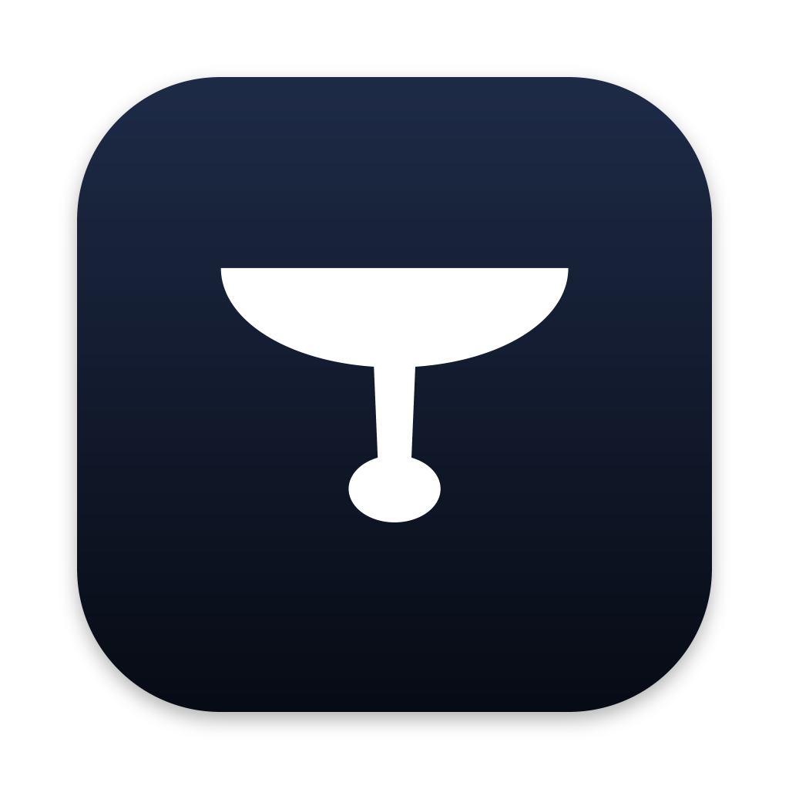
  <br>
  <sub>Scritto in Rust, disegnato con Metal.</sub>
</div>
